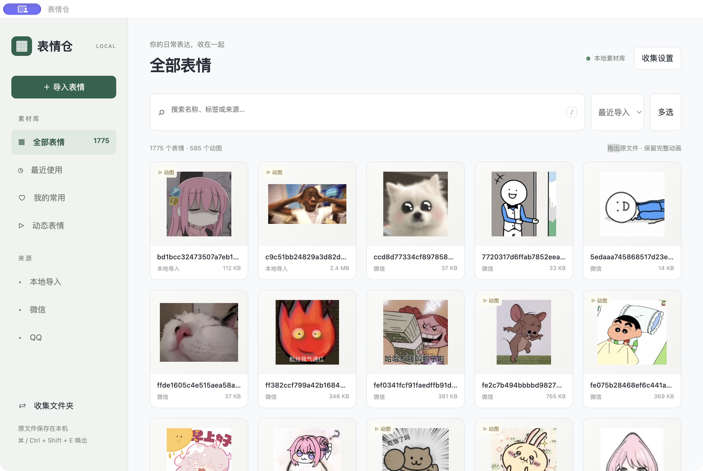
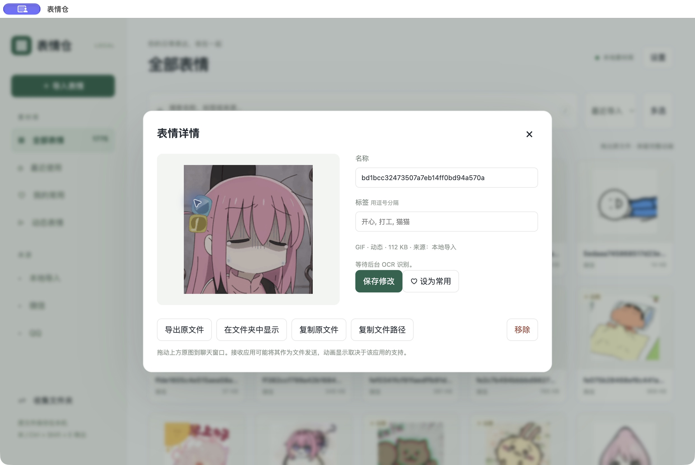
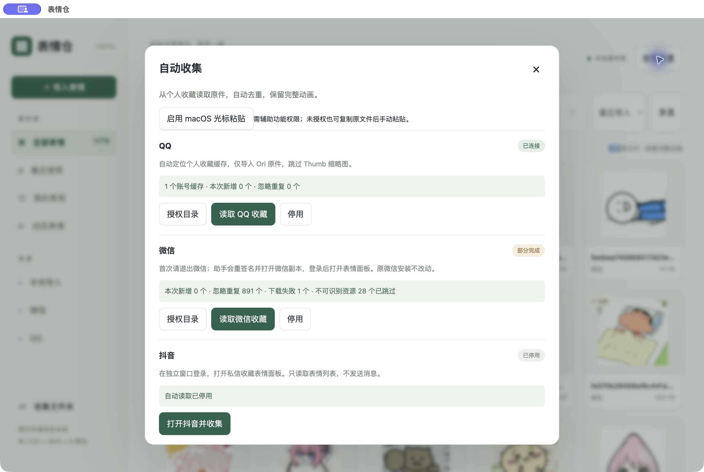

最近又做了一个小工具，叫 **表情仓，StickerVault**。

名字已经把用途说得差不多了：给表情包找一个能放在一起、也能随手拿出来的地方。

聊天时偶尔会遇到这种情况：明明记得自己存过一张特别合适的图，但它到底在微信收藏、QQ 收藏，还是电脑某个文件夹里？等翻出来，话题可能都已经过去了。

于是我给这些散落的表情做了一个本地素材库。把原文件收进来，按名称、标签或来源搜索，找到以后复制或者拖出去继续用。动图也要好好留着，不能收藏的时候还在动，拿出来就只剩一张静态图。

项目地址：[DanZai233/sticker-vault](https://github.com/DanZai233/sticker-vault)。

<!--more-->

## 先给表情找个家

表情仓是一个基于 Electron 的桌面应用，提供 macOS、Windows 和 Linux 安装包。

打开主窗口，左边是全部表情、最近使用、我的常用、动态表情，以及按来源划分的入口；右边是搜索框和表情卡片。整体用了偏浅的底色和绿色，想让它看起来像一个安安静静待在电脑里的小收纳柜。

截图时，库里已经有 **1775 个表情，其中 585 个动图**。到这个数量，靠滚动一张张找就有点考验耐心了，所以搜索、常用和最近使用都很实际。

导入的方式也尽量直接：点「导入表情」选择图片，或者把文件、文件夹拖进窗口。如果平时有固定存表情的目录，也可以关联成收集文件夹，在应用运行时定期检查新增内容。

同一张图从不同地方收进来，会按文件内容的 SHA-256 去重。文件名变了，也不用再占一个位置。

## 动图要留下原来的样子

这次很在意的一件事，是 **保留原件**。

表情仓支持 GIF、PNG/APNG、JPG 和 WebP，识别时会检查文件内容。保存、复制、拖出和导出都不重新编码、不压缩，动态预览也直接读取原件。

这听起来像一个实现细节，但对表情包来说很重要。有些图的笑点就在那几帧停顿和动作里，换成缩略图，味道就没了。

双击卡片可以打开详情，改名称、补标签、设为常用，也能导出原文件或在文件夹里找到它。

不过，保留动画原件和聊天软件最终怎么显示，是两件事。接收软件可能把拖进去的内容当图片，也可能当文件附件；动态 WebP、APNG 也未必都能直接播放。目前表情仓不会把它们统一转成 GIF，接收端不支持时，可以导出原件再选择文件发送。

至少在收进仓库的这一步，先把完整的东西留住。

## 把几个来源接起来

除了手动导入，我也做了 QQ、微信和抖音的收藏接入。

这部分实际做下来，最麻烦的是几个平台的收藏存储方式完全不同。

| 来源 | 怎么收集 | 目前需要注意的地方 |
| --- | --- | --- |
| QQ | 定位个人收藏缓存中的 `Ori` 原件，定期增量检查 | Mac 个人收藏已实测；未缓存的表情需要先在 QQ 收藏面板打开，Windows/Linux 路径适配仍属实验性 |
| 微信 | macOS / Windows 使用随包附带的第三方助手读取收藏 | 首次流程随系统不同；macOS 需要退出原微信、登录助手准备的副本，Windows 需保持微信 4.x 登录；Linux 可手动导入 |
| 抖音 | 在独立官方网页窗口登录，收集已加载的收藏列表 | 需要打开私信收藏表情面板并向下滚动，不是后台无人值守的全量同步 |
| 本地文件夹 | 关联目录，定期扫描新增图片 | 应用运行期间有效 |

QQ 这边只取个人收藏原件，跳过缩略图；抖音的动态表情只下载动画地址，失败了就显示失败，不拿静态预览凑数。

微信接入依赖第三方助手，并非官方开放接口。macOS 流程会在本机复制、重签名并运行微信副本，不修改原微信安装，但后续客户端更新仍可能让这套流程失效。具体操作和权限说明放在了仓库 README 里。

截图里的微信状态就是「部分完成」：有重复项被跳过，也有下载失败和不可识别的资源。能导入多少、哪里没成功，应该直接告诉使用的人，之后才知道该不该重试。

## 用的时候，最好不用找窗口

把表情存好以后，下一件事就是让它容易拿出来。

主窗口里单击表情会复制原文件，也可以直接拖动卡片到聊天窗口。但每次都切回主窗口，还是多了一步，所以我又做了菜单栏 / 系统托盘快捷面板。

点菜单栏图标，或者按 **⌘ / Ctrl + Shift + E**，就能叫出一个带搜索和缩略图的小面板，切换最近使用、常用或全部表情。搜索覆盖整个素材库，列表也可以继续加载。

我更希望它成为这样一个动作：聊到一半，按快捷键，找张图，用完就继续聊天。

macOS 还支持在授予辅助功能权限后，记住打开面板前的应用，选中表情后恢复那个应用并执行粘贴。它不会自动按回车发送消息，最后发不发仍然自己决定。

没有授权也能复制原文件，再回聊天窗口手动粘贴。Windows 和 Linux 目前主要提供复制和拖出，自动恢复应用并粘贴的能力还没有实现。

「最近使用」记录的也是在表情仓里的使用操作，不读取聊天软件的发送历史，更不能判断一次拖拽最后有没有成功发出去。

## 文件名记不住，让图片里的字帮忙

很多表情导入以后，名字都是一长串字符。像截图里的文件名，光看名字几乎猜不出是什么。

新版里加了 **后台 OCR 自动标签**：用随安装包附带的本地简体中文和英文模型识别图片文字，提取标签，识别全文也可以参与搜索。这样找带字的表情时，就多了一个入口，不用每张都手动起名。

模型在本地运行，识别不上传图片。后台一张张慢慢处理，可以暂停，下次启动接着处理剩余内容；处理记录按原件内容哈希保存，避免反复折腾同一张图。

它也有很明确的局限：小字、花字、模糊背景可能认不准，动图只取一帧，后面几帧出现的字可能漏掉。它做的是文字检索，不会自动理解一张猫猫图到底是开心、委屈还是阴阳怪气。

所以名称、标签仍然可以自己修改。机器先帮忙做一点，人再补上自己会怎么找这张图。

## 桌面工具里那些看不见的小事

技术上，主干是 Electron 和本地文件存储：窗口、托盘、全局快捷键、原生文件拖拽，以及各来源的导入适配。macOS 额外做了原生剪贴板和粘贴助手，OCR 则放在隔离的识别进程里。

表情原件和元数据都保存在本机，没有云同步、广告或统计服务。连接平台来源时，仍会访问相应的官方网站或图片 CDN；「本地保存」不等于所有功能都不联网。

备份也需要留意：只导出图片，带不走标签和常用状态。如果想完整备份，需要退出应用后复制整个 `vault/` 目录，把原件和元数据一起留住。

关闭主窗口以后，应用可以继续待在菜单栏或系统托盘里收集；真正退出要从托盘菜单操作。新版也补了可选的登录后自动启动，默认关闭，开启后在后台待着，需要时再叫出来。

这些地方没有表情卡片那么显眼，但一个工具能不能长期放在电脑里，往往就取决于它平时是否省心。

## 给自己的表情包留个位置

做这种小工具的乐趣，是需求特别具体。

看到一张图想存下来，存完以后想找得到，找到以后想顺手发出去。一路做下去，就会碰到格式、缓存、系统权限、剪贴板和接收软件兼容性这些问题。每解决一点，日常使用就顺一点。

现在的表情仓已经可以把这条流程串起来了。跨平台安装包也配了构建，不过各聊天软件的真实账号和权限环境仍需要继续验证，具体支持范围以仓库说明为准。

如果你也有一堆散落在不同地方的表情，可以来看看：

- 源码：[DanZai233/sticker-vault](https://github.com/DanZai233/sticker-vault)
- 安装包：[GitHub Releases](https://github.com/DanZai233/sticker-vault/releases)

希望下次聊天时，脑海里闪过的那张图，真的能及时找到。
